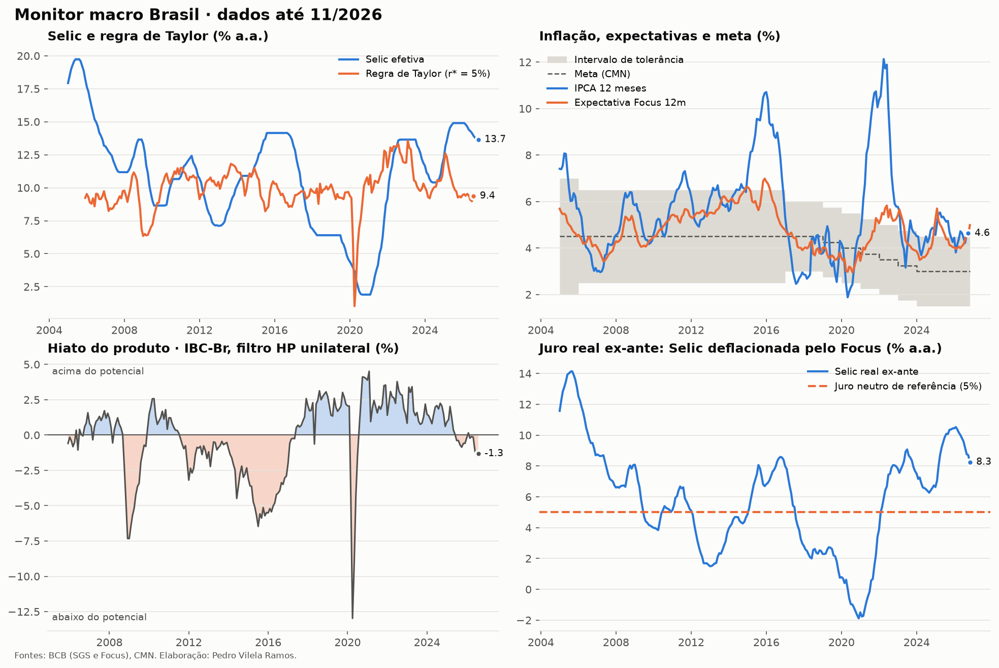

# Relatório do monitor macro

*Gerado automaticamente em 15/10/2026.*

## Últimos números

| Indicador | Valor | Referência |
|---|---:|---:|
| Selic efetiva (% a.a.) | 13.65 | 10/2026 |
| IPCA 12 meses (%) | 4.58 | 09/2026 |
| Expectativa Focus 12m (%) | 4.55 | 10/2026 |
| Meta de inflação (%) | 3.00 | 10/2026 |
| Hiato do produto (%) | -1.58 | 07/2026 |
| Juro real ex-ante (% a.a.) | 8.71 | 10/2026 |
| Regra de Taylor, r* = 5% (% a.a.) | 8.95 | 07/2026 |
| Regra estimada, alvo (% a.a.) | 11.70 | 07/2026 |
| Selic − regra de Taylor (p.p.) | 5.20 | 07/2026 |

## Regra de Taylor estimada

Amostra mensal 2005-12 a 2026-07.
$i_t - \pi^*_t = c + \rho\,(i_{t-1} - \pi^*_t) + b\,(E_t\pi_{t+12} - \pi^*_t) + d\,\tilde y_t + \varepsilon_t$

(forma linear de $i_t = \rho\, i_{t-1} + (1-\rho)[r^* + \pi^* + \phi_\pi(E\pi - \pi^*) + \phi_y \tilde y]$, com a meta passando 1 para 1 ao juro no longo prazo)

| Variável | Coeficiente | Erro-padrão (HAC) | p-valor |
|---|---:|---:|---:|
| Constante | 0.039 | 0.068 | 0.565 |
| Selic defasada − meta (ρ) | 0.965 | 0.010 | 0.000 |
| Expectativa − meta | 0.279 | 0.046 | 0.000 |
| Hiato | 0.038 | 0.013 | 0.003 |

R² = 0.994 · N = 248

**Coeficientes de longo prazo**

| Parâmetro | Valor |
|---|---:|
| Suavização ρ | 0.965 |
| Resposta às expectativas φπ | 8.03 |
| Resposta ao hiato φy | 1.10 |
| Juro real implícito com Eπ = meta e hiato zero, r* (% a.a.) | 1.13 |

Leitura: o juro real ex-ante implícito na regra é
$r_t = i_t - E_t\pi = r^* + (\phi_\pi - 1)(E_t\pi - \pi^*) + \phi_y \tilde y_t$.
O **princípio de Taylor** pede φπ > 1: quando as expectativas sobem, o BC tem de
subir o juro nominal mais que 1 para 1, de modo que o juro **real** também suba.
Estimado aqui: φπ = 8.03 (satisfaz o princípio no longo prazo).

Cuidado na leitura: como as expectativas ficaram acima da meta na maior parte
da amostra, φπ e r* são difíceis de separar. Um φπ alto combinado com um r*
baixo descreve o mesmo juro real médio que um φπ menor com um r* mais alto.
Por isso o painel usa a regra calibrada, com r* = 5%, e a regra estimada fica
só neste relatório.

## Curva de Phillips (trimestral)

Amostra 2006Q1 a 2026Q3, com dummies sazonais.
$\pi_t = c + \beta_f E_t\pi_{t+1} + \beta_b\,\pi_{t-1} + \gamma\,\tilde y_{t-1} + \delta\,\Delta e_{t-1} + \varepsilon_t$

| Variável | Coeficiente | Erro-padrão (HAC) | p-valor |
|---|---:|---:|---:|
| Constante | 0.930 | 0.440 | 0.035 |
| Expectativa (βf) | 0.217 | 0.491 | 0.658 |
| Inflação defasada (βb) | 0.372 | 0.142 | 0.009 |
| Hiato defasado (γ) | -0.023 | 0.029 | 0.419 |
| Δ câmbio defasado (δ) | 0.014 | 0.013 | 0.282 |

R² = 0.370 · N = 83

Soma βf + βb = 0.59
(próximo de 1 indica curva vertical no longo prazo).
